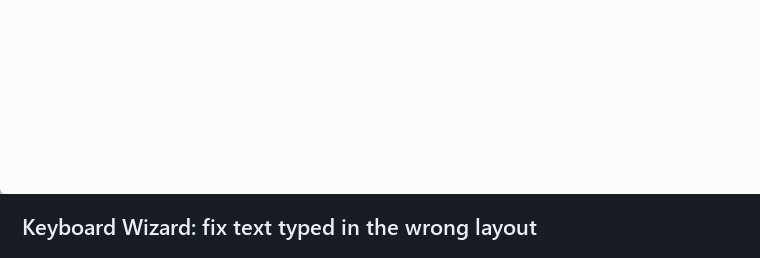

# Keyboard Wizard

Fix text typed in the wrong keyboard layout: select it, press **Ctrl+Alt+W**, and it's retyped in the right language, Hebrew and English in both directions, with no keylogger.

**Supports Windows 10 and 11.**

[](https://github.com/dotcomico/keyboard-wizard-hotkey/actions/workflows/tests.yml)




```
You typed (English layout on):   akuo kl tbh
Select it, press Ctrl+Alt+W:     שלום לך אני
```

The selection is replaced in place, and the window's input language switches to Hebrew so you can keep typing. It works the other way too: `שלום` becomes `akuo`.

## Download and use

1. Download the latest **KeyboardWizard** exe from [Releases](https://github.com/dotcomico/keyboard-wizard-hotkey/releases).
2. Run it. No installer and no admin rights needed. A blue "KW" keycap appears in the system tray (check the `^` overflow area).
   - Windows SmartScreen may warn you because the exe isn't code-signed. Click **More info**, then **Run anyway**.
3. In any app, select text you typed in the wrong layout and press **Ctrl+Alt+W**.
4. Optional: right-click the tray icon and tick **Run at startup**.

Both **English (US)** and **Hebrew** keyboards should be installed in Windows (Settings > Time & language > Language & region) for the language switch. Without the target keyboard, the text is still converted and a notification tells you the keyboard is missing.

## Features

- **Both directions, detected automatically.** If the selection has Hebrew letters and at least as many Hebrew as Latin letters, it's converted Hebrew to English; otherwise English to Hebrew.
- **Physical key position mapping** (US QWERTY and standard Hebrew), including punctuation. Digits, spaces, emoji and anything else without a mapping pass through unchanged.
- **Works in ordinary Windows apps**: Notepad, browsers, VS Code, Electron apps such as Slack.
- **Switches the input language** of the window to the conversion's target (can be turned off).
- **Clipboard left as it was.** Your clipboard text is restored after each conversion, and the app's own clipboard writes are excluded from Win+V history and cloud clipboard.
- **Tray status.** The tooltip shows the active hotkey and the last result; the menu shows both on their own lines. Problems (no text selected, window changed, hotkey taken by another app, ...) also show a notification; successful conversions stay silent.
- **Single instance.** Starting it a second time exits silently.

| You typed | Result | Direction |
|---|---|---|
| `akuo` | `שלום` | English to Hebrew |
| `vhh` | `היי` | English to Hebrew |
| `tbh kt hus` | `אני לא יוד` | English to Hebrew |
| `שלום` | `akuo` | Hebrew to English |

English uppercase maps to the same Hebrew letter as lowercase; Hebrew to English output is lowercase.

## Privacy

Most layout-fixer tools watch every keystroke to guess when you've typed gibberish. Keyboard Wizard does not, by design:

- **No keyboard hook, no keylogger.** The app never installs a `SetWindowsHookEx` hook or uses a hooking library. The only key combination it can see is its own hotkey, registered with the Win32 `RegisterHotKey` API, which notifies the app of that one combination and nothing else.
- **It reads only what you hand it.** Text is read once, from the selection, at the moment you press the hotkey. Copy and paste are sent with `SendInput`.
- **Nothing is stored.** Selected and converted text is never written to the log, the config file or anywhere else. The log records only statuses, text lengths and the conversion direction.
- **No network access.** Everything happens locally.

## Configuration

Right-click the tray icon to see the last status and the active hotkey, and for:

- **Run at startup**: adds or removes a `KeyboardWizard` value under `HKCU\Software\Microsoft\Windows\CurrentVersion\Run` (per-user, no admin rights). This is the same entry Task Manager's Startup apps tab shows.
- **Switch keyboard language after convert**: on by default.
- **Quit**.

Settings are saved in `%APPDATA%\KeyboardWizard\config.json`, created with defaults on first run. Edit it while the app is closed, then start the app again. Unknown keys are dropped, missing keys get defaults, and a corrupt file is reset. Delete the file to reset everything.

| Key | Default | Meaning |
|---|---|---|
| `hotkey` | `"ctrl+alt+w"` | The global hotkey: one or more of `ctrl`, `alt`, `shift`, `win` plus one key `a`-`z`, `0`-`9` or `f1`-`f24`, joined with `+`. An invalid value falls back to `ctrl+alt+w`. The tray tooltip and menu show the active hotkey. |
| `run_at_startup` | `false` | Mirrors the Run-key entry; the registry is re-read at every launch. Use the tray toggle. |
| `switch_layout_after_convert` | `true` | Switch the window's input language to the target after pasting. |
| `keep_result_on_clipboard` | `false` | Leave the converted text on the clipboard instead of restoring what was there before. |

The log is `%APPDATA%\KeyboardWizard\kbwizard.log` (rotating, 1 MB x 2 backups).

### Uninstall

1. Untick **Run at startup** in the tray menu (or remove it in Task Manager > Startup apps), then choose **Quit**.
2. Delete the exe.
3. Delete the `%APPDATA%\KeyboardWizard` folder (settings and log).

## Known limitations

- **Elevated (admin) windows.** Windows (UIPI) blocks a normal app from sending input to an elevated one, so the copy never arrives and you get "No text selected." Run Keyboard Wizard as admin too if you need it there.
- **Only text clipboard content is restored.** If an image or files were on the clipboard when you pressed the hotkey, they're replaced and lost.
- **Terminals with copy-on-select** (Windows Terminal, the VS Code terminal) handle paste their own way: some paste at the cursor (the end of the prompt) instead of replacing the selection.
- **Mixed Hebrew and English selections** are converted in one direction only, chosen by the majority rule above. Characters of the other script pass through unchanged.
- **The target app's own Ctrl+C** may still appear in Win+V history. That copy is made by the app you're in, so Keyboard Wizard can't mark it as excluded.
- **Read-only text:** nothing changes. The paste is ignored by the target, and the clipboard is still restored.
- **Short delay.** Each conversion waits 0.25 s after pasting before restoring the clipboard (see design decisions below).
- **Windows only.** Linux and macOS aren't supported: the hotkey, key injection, clipboard handling and language switch all use Win32 APIs. The conversion logic in `kbwizard/core/` has no OS calls, so a port would only need new adapters.
- **English (US QWERTY) and Hebrew only** for now. The layout tables are keyed by physical scan code, so adding a language means adding a table.

## For developers

### Requirements

- Windows 10 or 11
- Python 3.14 (the tested version, also used by CI)
- Runtime dependencies in [requirements.txt](requirements.txt): `pywin32`, `pystray`, `Pillow`
- Development dependencies in [requirements-dev.txt](requirements-dev.txt): the above plus `PyInstaller` and `pytest`

Versions are pinned to the ones the app is tested with.

### Setup

Always use the project's virtual environment:

```powershell
python -m venv .venv
.\.venv\Scripts\python.exe -m pip install -r requirements-dev.txt
```

Use `requirements.txt` instead if you only want to run the app from source.

### Run from source

```powershell
.\.venv\Scripts\python.exe -m kbwizard.main
```

When started from source, **Run at startup** registers `pythonw.exe kbwizard\main.py` (no console window); the built exe registers itself.

### Tests

```powershell
.\.venv\Scripts\python.exe -m pytest -q
```

Unit tests fake every OS collaborator (clipboard, `SendInput`, `RegisterHotKey`, the registry), so they run without a desktop session. The two smoke tests that register a real hotkey are skipped when the `CI` environment variable is set; GitHub Actions runs the suite on every push and pull request. `tests/test_layout_os.py` cross-checks the conversion table against the real Windows Hebrew layout and is skipped if Hebrew isn't installed. Behaviour that needs a live desktop (real apps, Win+V history, admin windows, the built exe) is covered by the checklist in [manual_tests/README.md](manual_tests/README.md).

### Build the exe

```powershell
.\build.bat
```

Runs PyInstaller with [KeyboardWizard.spec](KeyboardWizard.spec) and produces `dist\KeyboardWizard.exe`: a single windowed file (tray only, no console) with the icon bundled. UPX compression is off, because packed exes that inject input and use the clipboard are more often flagged by antivirus.

### Project layout

```
kbwizard/
  main.py      entry point: logging, single-instance mutex, DPI awareness, wiring
  app/         application shell: per-press pipeline, settings, tray menu, startup entry, status messages
  win32/       thin Win32 adapters: RegisterHotKey listener, SendInput, clipboard, input-language switch
  core/        pure conversion logic: scan-code layout tables and the converter (no I/O, no Win32)
tests/         unit tests, every OS call faked
manual_tests/  live-desktop checklist and scripts
tools/         layout cross-check against Windows, icon generator
assets/        tray and exe icon
```

Dependencies point one way: `app` > `win32` > `core`. The pure modules are what make most of the logic unit-testable.

### How it works

```
Ctrl+Alt+W (RegisterHotKey, on its own message-loop thread)
  > remember the foreground window; ignore the press if one is already running
  > worker thread: wait until the hotkey's keys are physically released
  > capture the selection: save clipboard > SendInput Ctrl+C > read > restore
  > detect direction > convert by physical key position
  > foreground window unchanged? (otherwise: "Window changed - nothing pasted.")
  > paste: write result > SendInput Ctrl+V > wait 0.25 s > restore clipboard
  > switch the window's input language to the target (optional)
  > report a status to the tray
```

### Key design decisions

- **`RegisterHotKey` instead of a keyboard hook.** A low-level hook (or libraries like `keyboard`/`pynput`) sees every keystroke system-wide. `RegisterHotKey` delivers only the registered combination, which makes "we can't keylog" a property of the architecture rather than a promise. Hotkeys use virtual-key codes, so Ctrl+Alt+W still fires while the Hebrew layout is active.
- **Mapping by physical key, not by letter.** Layouts are tables keyed by keyboard scan code (plus Shift), and conversion goes through a reverse map: character > physical key > character on the other layout. This is exactly what happened when the user typed, it covers punctuation, and adding a language is a new table rather than new logic.
- **Wait for the hotkey to be released before copying.** If Ctrl+C were injected while Alt is still held, the app would receive Ctrl+Alt+C. The worker waits for the keys to come up, and forces key-ups after a timeout so modifiers are never left stuck.
- **Restore the clipboard 0.25 s after pasting, not immediately.** Chromium and Electron apps read the clipboard asynchronously after Ctrl+V; restoring sooner makes them paste your old clipboard instead of the converted text.
- **Switch languages only among installed layouts.** The app asks the window to change its input language, choosing from keyboards already installed; it never calls `LoadKeyboardLayout`, which would add a keyboard to the user's language list.

## Background

Successor to an earlier hook-based prototype of Keyboard Wizard; this version has no keyboard hook, works in both directions and uses a fixed conversion table.

## License

Copyright (c) 2026 Dotan Siman Tov. All rights reserved.

Keyboard Wizard is free for personal, non-commercial use. It may not be sold, redistributed without permission, modified or claimed as anyone else's work. See [LICENSE](LICENSE) for the full terms.
